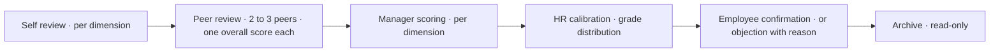
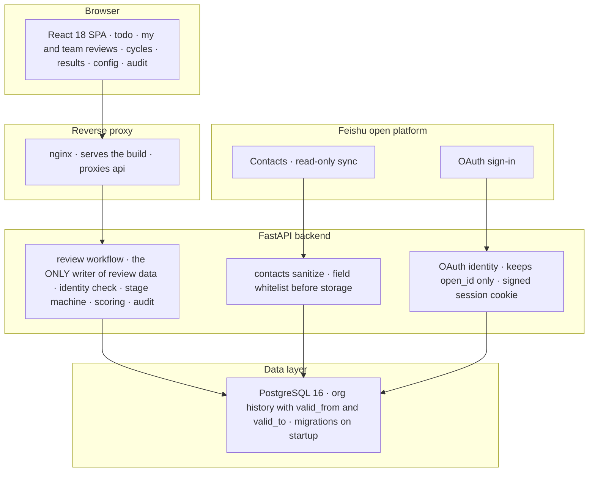

# KPISYS · Employee Performance Review System

**One monthly cycle that every review must walk through: self-review → peer review → manager scoring → HR calibration → employee confirmation → archive.**

Feishu (Lark) is the directory and the sign-in; everything about the review itself — metrics, weights, score scale, grades, coefficients — is configuration, never code. FastAPI + SQLAlchemy + PostgreSQL behind React + Vite, deployed with Docker.

[Overview](#-overview) · [Review Cycle](#-review-cycle) · [Architecture](#-architecture) · [Design Highlights](#-design-highlights) · [Guard Rails](#-guard-rails) · [Tech Stack](#-tech-stack)

**English** · [简体中文](README.zh.md)

> [!NOTE]
> This is a **documentation-only showcase**: no source code is published here. The implementation lives in a private repository. Contact the author to arrange a guided code walkthrough.

## 📌 Overview

Once a month, every participating employee gets one review sheet. The employee scores themselves per dimension and nominates 2–3 peers; the peers each give one overall score; the manager scores per dimension; HR sees the grade distribution and calibrates; the employee confirms — or objects, with a reason; the cycle archives read-only. A quarterly review variant runs the same machinery **without scores** — progress and feedback only.

Two things make the system worth having:

- **Nothing about the review is hardcoded.** Metrics, weights, scoring standards, the score scale, grade thresholds, performance coefficients, and the applicability rules that decide who gets which template — all of it is configuration data, maintained in the UI or round-tripped as JSON with a preview-before-write import.
- **Nothing can happen out of order, and nothing happens silently.** Stage transitions are a state machine that only HR can advance; every write to a review sheet goes through one workflow module that checks identity and stage, computes scores, and writes an audit row.

## 🔄 Review Cycle

- The stage machine is advanced **only by HR**; a forced advance records skipped steps instead of faking completion.
- Final score = manager score × (1 − w) + peer average × w, where w is the cycle's peer weight — computed in `Decimal`, never float.
- Peer review is anonymous to the subject: only the count before publication, then the average and unordered comments. The manager and HR see everyone.
- Creating a cycle **snapshots** the grade scale; creating a sheet snapshots the template dimensions and the reviewer — editing configuration never touches a running cycle.

## 🏗 Architecture

- **One writer.** Review sheets are only modified through the workflow module; the API layer never touches their fields directly, so permission checks and the audit trail cannot be bypassed by a new endpoint.
- **Snapshot, don't reference.** Cycles copy the grade scale; sheets copy the template dimensions and reviewer at creation time.
- **Fail safe on sync.** A suspicious headcount drop skips departure marking; zero people aborts the write entirely.

## 💡 Design Highlights

**The review engine is pure configuration.** A template holds dimensions with weights that must total 100 to activate; applicability rules match by person over department over company default, then split manager/staff; a grade scale defines the score range, thresholds and coefficients. Config export/import uses named references, upserts by name, dry-runs a preview, and commits in one audited transaction.

**Organization data is never physically deleted.** Departures and transfers set an inactive flag; department membership and reporting lines are closed with `valid_from`/`valid_to` and reopened as new rows, because reviews must be traceable to the org as it was.

**Review relations are derived, then human-confirmed.** Direct manager → department leader → up the tree, with per-person HR overrides. Fallback derivations are suggestions, never silently applied.

**Sign-in takes identity and nothing else.** The OAuth flow keeps `open_id`/`user_id` and discards everything else, including the user access token. No auto-registration: only synced active employees and the built-in admin may sign in.

## 🛡 Guard Rails

- **A field whitelist guards the door.** The directory API returns whatever the app's permissions expose — phone, email, employee number — regardless of token scope. The whitelist drops everything the system did not ask for before it is stored, and tests hold that line.
- **A sync safety threshold**: if the fetched headcount drops beyond a configured ratio, the run refuses to mark anyone as departed — a permissions change should not look like a layoff. Sync runs are serialized with a database advisory lock.
- **Field visibility is trimmed by identity**: an employee cannot see the manager's scores or the grade before confirmation; calibration notes are HR-only; an HR person's own review renders with employee-level visibility, and they cannot calibrate themselves.
- **Every write is audited** with the operator, the *actual* signed-in user — they differ in identity-switch rehearsal mode — and before/after values.
- **A protected built-in admin** is recreated on every startup and cannot be demoted or disabled; accounts are soft-deleted so audit logs never lose their actor.
- **Test data is quarantined**: rehearsal data carries an `is_test` flag and a visible tag — generated to any stage in one click, wiped in one click, never touching real configuration or org data.
- **Every list is paginated** — server-side where data grows — through one shared pagination helper.
- **Schema changes only through migrations**, applied automatically on startup.
- **129 backend tests** run against a real PostgreSQL — scoring and grade mapping, permission isolation, the stage machine, relation derivation, the sanitize whitelist, OAuth handling, sync with history rows, config import/export, and test-data cleanup.

## 🧱 Tech Stack

| Layer | Choice |
|---|---|
| Backend | Python 3.12, FastAPI, SQLAlchemy 2, Pydantic 2, migrations via Alembic |
| Database | PostgreSQL 16 — org history with `valid_from`/`valid_to`, `Decimal` scoring |
| Frontend | React 18.3, TypeScript, Vite, React Router |
| Auth | Signed session cookie; Feishu OAuth for identity only |
| Integration | Feishu contacts, read-only, field-whitelisted on the way in |
| Testing | pytest against a dedicated test database, rebuilt per run |
| Deployment | Docker Compose: database, backend, and an nginx frontend that proxies the API |

## 📄 License

All rights reserved. Documentation only; no license is granted for the described implementation.
