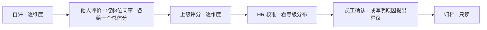
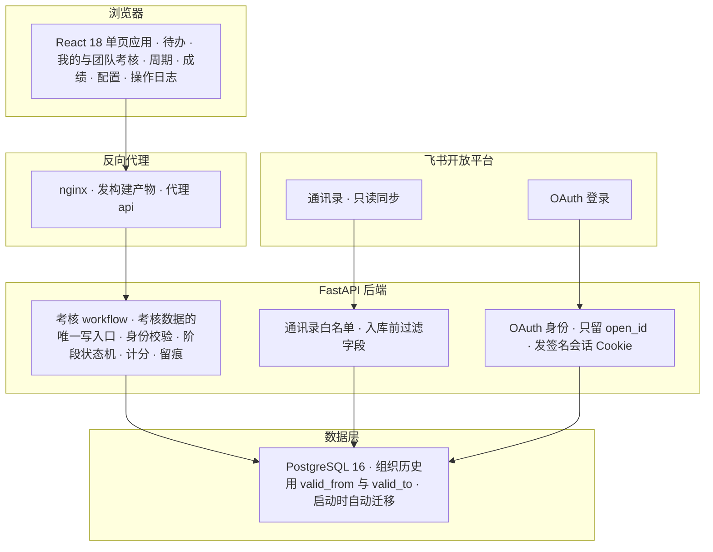

# KPISYS · 员工绩效考核系统

**每月一个周期，每张考核单都要走完同一条线：自评 → 他人评价 → 上级评分 → HR 校准 → 员工确认 → 归档。**

飞书是组织架构数据源和登录方式；考核本身的一切 —— 指标、权重、分制、等级、系数 —— 全是配置，代码里一个都不写死。FastAPI + SQLAlchemy + PostgreSQL，前端 React + Vite，Docker 部署。

[概述](#-概述) · [考核周期](#-考核周期) · [架构](#-架构) · [设计要点](#-设计要点) · [工程铁律](#-工程铁律) · [技术栈](#-技术栈)

[English](README.md) · **简体中文**

> [!NOTE]
> 这是一份**纯文档 showcase**：本仓库不包含任何源码。实现在私有仓库中。如需了解实现细节，可联系作者安排代码走读。

## 📌 概述

每个月，每位参与考核的人都有一张考核单。员工逐维度给自己打分，并提名 2–3 位同事；每位同事给一个总体分；上级逐维度评分；HR 看全员等级分布做校准；员工确认结果 —— 有异议要写明原因；周期归档后全程只读。另有季度回顾走同一套机制但**不打分** —— 只写进展和反馈。

这套系统真正值钱的是两件事：

- **考核内容一个都不写死。** 指标、权重、考核标准、分制、等级阈值、绩效系数，以及决定谁用哪套模板的适用规则 —— 全部是配置数据，在页面上维护，或导出 JSON 改完再导入，先预览、后写入。
- **步骤不能乱序发生，改动不能悄悄发生。** 阶段推进是一个只有 HR 能推的状态机；考核单的每次写操作都走同一个 workflow 模块 —— 校验身份和阶段、计分、写留痕。

## 🔄 考核周期

- 阶段状态机**只有 HR 能推进**；强制推进会把没完成的人记为「跳过」，而不是伪造完成。
- 最终分 = 上级评分 ×（1−w）+ 他人平均分 × w，w 是周期的他人评价占比 —— 用 `Decimal` 计算，从不用浮点。
- 他人评价对本人匿名：结果公布前只看到人数，公布后只看到平均分和不标顺序的评语；上级和 HR 看得到每一位。
- 建周期时**快照**等级方案；建考核单时快照模板维度和考核人 —— 改配置永远不影响进行中的周期。

## 🏗 架构

- **只有一个写入口。** 考核单只能通过 workflow 模块修改，接口层不直接碰字段 —— 新加一个端点也绕不开权限检查和留痕。
- **快照，不引用。** 周期复制等级方案，考核单复制模板维度和考核人，都在创建那一刻定格。
- **同步出错就收手。** 人数骤降跳过离职标记；读到 0 人直接放弃写入。

## 💡 设计要点

**考核引擎是纯配置。** 模板带维度和权重，合计 100 才能启用；适用规则按「个人 > 部门 > 全公司默认」匹配，再分经理/员工；等级方案定义分制范围、阈值和系数。配置导入导出按名称引用、有则更新无则新建、先预演后写入、一个事务、全程留痕。

**组织数据从不物理删除。** 离职、调出只标不在职；所属部门和汇报线用 `valid_from`/`valid_to` 关旧行、开新行 —— 考核要能追溯当时的组织归属。

**考核关系先推导、后人工确认。** 直属上级 → 部门负责人 → 逐级向上，HR 可逐人覆盖。兜底推导只是建议，从不自动生效。

**登录只认身份，别的一概不要。** OAuth 流程只留 `open_id`/`user_id`，其余一律丢弃，用户访问令牌用完即弃。不自动注册：只认同步范围内的在职人员和内置管理员。

## 🛡 工程铁律

- **字段白名单把门。** 通讯录接口返回什么取决于应用开通的权限 —— 手机号、邮箱、工号会一并下发，缩小 token scope 也挡不住。白名单在入库前丢弃一切系统没要的字段，并有测试守着这条线。
- **同步安全阈值**：读到的在职人数骤降超过设定比例时，拒绝执行离职标记 —— 权限变化不该看起来像一场裁员。同步用数据库咨询锁互斥。
- **字段可见性按身份裁剪**：员工在确认阶段前看不到上级评分和等级；校准说明只给 HR；HR 看自己的考核单仍按员工口径，且不能校准自己。
- **每次写操作都留痕**：操作人、**实际登录人**（切换身份演练时两者不同）、前后值。
- **内置管理员受保护**：每次启动自动恢复，不能降级、不能停用；账号软删除，操作日志永远不丢操作人。
- **测试数据隔离**：演练数据带 `is_test` 标记和可见的「测试」标签 —— 一键生成到任意阶段、一键全部清除，不碰正式配置和组织数据。
- **列表一律分页** —— 数据会变大的走服务端分页 —— 全站共用同一个分页工具。
- **表结构只走迁移**，启动时自动执行。
- **129 个后端测试**连真 PostgreSQL 跑：计分与等级映射、权限隔离、阶段状态机、考核关系推导、字段白名单、OAuth 处理、带历史行的同步、配置导入导出、测试数据清除。

## 🧱 技术栈

| 层 | 选型 |
|---|---|
| 后端 | Python 3.12、FastAPI、SQLAlchemy 2、Pydantic 2、迁移走 Alembic |
| 数据库 | PostgreSQL 16 —— 组织历史用 `valid_from`/`valid_to`，计分用 `Decimal` |
| 前端 | React 18.3、TypeScript、Vite、React Router |
| 鉴权 | 签名会话 Cookie；飞书 OAuth 只认身份 |
| 集成 | 飞书通讯录，只读，入库前过字段白名单 |
| 测试 | pytest 连专用测试库跑，每次重建 |
| 部署 | Docker Compose：数据库、后端、代理接口的 nginx 前端 |

## 📄 许可

保留所有权利。本仓库仅为文档；不对所述实现授予任何许可。
